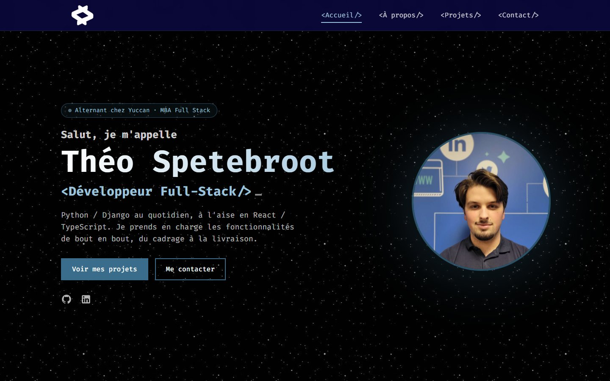

# Théo Spetebroot · Portfolio

Mon portfolio de développeur web full-stack, alternant chez Yuccan et en MBA Développeur Full Stack à MyDigital School Paris.

👉 **[theo-spetebroot.com](https://theo-spetebroot.com)**



## Stack

- **React 19** + **TypeScript**
- **Tailwind CSS 3**
- **React Router 6**
- **Create React App** (react-scripts 5)

## Fonctionnalités

- Pages Accueil, Projets, fiche projet, Contact, Politique de confidentialité et 404
- Tous les projets décrits dans un seul fichier de données : [`src/data/projects.ts`](src/data/projects.ts)
- Design responsive, animations au scroll, respect du réglage système « réduire les animations »
- SEO : titre et URL canonique par page, balises Open Graph pour l'aperçu au partage, `sitemap.xml`, `robots.txt`
- `.htaccess` inclus pour que les liens directs fonctionnent sur un hébergement Apache (OVH)

## Lancer le projet

```bash
npm install
npm start       # serveur de développement sur http://localhost:3000
npm run build   # version de production dans /build
```

## Structure

Les composants sont organisés en **atomic design** :

```
src/
├── components/
│   ├── atoms/        # éléments de base : Button, SectionTitle, ScrollToTop
│   ├── molecules/    # sections et cartes : présentation, projets, compétences, parcours...
│   ├── organisms/    # header et footer
│   └── pages/        # pages complètes : accueil, projets, contact, 404...
├── data/
│   ├── projects.ts   # contenu de tous les projets
│   └── skillsIcons.ts
├── hooks/            # useScrollAppear (animations), usePageTitle (titre + SEO)
└── assets/           # images, logos et PDF (CV, documentations)
public/               # index.html, icônes, image de partage, sitemap, robots.txt, .htaccess
```

## Ajouter un projet

1. Ajouter le logo dans `src/assets/logo/` (et une capture dans `src/assets/img/` si besoin).
2. Ajouter un objet dans le tableau de [`src/data/projects.ts`](src/data/projects.ts).
   `archived: true` le range dans « Anciens projets » ; pour le mettre en avant sur l'accueil, ajouter son `id` dans `selectedProjectIds` de `src/components/molecules/projets.tsx`.
3. Ajouter son URL (`/projets/<slug>`) dans [`public/sitemap.xml`](public/sitemap.xml).

## Déploiement

Le site est hébergé chez **OVH**. Après `npm run build`, il suffit d'envoyer le contenu du dossier `/build` à la racine du site (le fichier `.htaccess` est inclus dans le build).

## Contact

- [LinkedIn](https://www.linkedin.com/in/th%C3%A9o-spetebroot/)
- [theo.spetebroot@gmail.com](mailto:theo.spetebroot@gmail.com)
